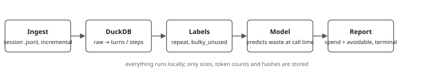

# tokenwise

See where your Claude Code token spend goes, and how much of it you could save. Runs entirely on your machine.

Real output on 40 synthetic sessions (generated with `scripts/make_demo_sessions.py`, so the numbers say nothing about typical usage):

```
$ tokenwise report
Sessions analyzed: 40
Estimated spend: $124.27
Avoidable: $22.44 (18%)

Top leaks
  1. bulky_unused     $15.56
  2. repeat           $4.67
  3. other patterns   $2.21

Model: personal (AUC 0.78)
```

## Install

```
pipx install .        # or: uv tool install .
tokenwise report
```

By default it reads `~/.claude/projects`; use `--sessions-dir` and `--db` to change locations.
Commands: `ingest`, `train`, `report`, `skills`. `train` and `report` save the trained model next to the database (`model.skops`) and reuse it until the data changes; `--retrain` forces a new one.

## Which skills cost you tokens

Every installed skill adds its name and description to the prompt of every session, whether you use it or not. `tokenwise skills` lists them all by the estimated cost of carrying that text, with how many times you used each one, and marks the ones with zero uses as `unused`.

```
$ tokenwise skills            # last 30 days; use --days N to change
Skills loaded in 12 sessions (last 30 days)
Estimated cost of carrying skill descriptions: $1.20 (~900 tokens/session). Token counts are estimates.
Data covers 2026-01-01 to 2026-01-12 (12 days), less than the 30 requested

By plugin
  big-plugin   3 skills  ~700 tokens/session  0 uses  $0.90  unused
  my-tools   1 skills  ~200 tokens/session  5 uses  $0.30

All skills
  big-plugin:pdf   ~400 tokens/session  0 uses  $0.50  unused
  ...
```

(Synthetic numbers.) Token counts are estimated from the length of each description, and uses include both the Skill tool and `/skill` commands. Only skill names and description lengths are stored, never the text.

## Use it from Claude Code

The repo is also a Claude Code plugin with one skill, so you can ask "where is my token spend going?" inside a session.

```
/plugin marketplace add FrMahon/tokenwise
/plugin install tokenwise@tokenwise
```

On Claude Code 2.1.275 or later, one step is enough: `/plugin install tokenwise --marketplace FrMahon/tokenwise`.

The skill only runs the `tokenwise` command; it does not install it. If the command is missing, it shows you the install line above and waits for you. Because Claude runs the report, its summary (spend, avoidable share, top leaks; no conversation text) appears in your session.

## How it works



1. **Ingest** the session files incrementally; unknown or truncated lines are skipped, never fatal.
2. **DuckDB layers** (SQL): raw events → deduplicated turns → tool-call steps.
3. **Labels** derived from the data: a step is *waste* if it repeats an identical earlier call+result, or returns a large result that nothing follows up on.
4. **Model** (gradient boosting) learns from your history to predict waste using only what is known when the tool is called. With fewer than 2000 steps it falls back to a bundled baseline.
5. **Report** prices the predicted waste with `pricing.toml`.

## Privacy

Nothing leaves your machine. Conversation text is never stored: only token counts, result sizes and SHA-1 hashes of inputs and results.

## Security

See [SECURITY.md](SECURITY.md). The bundled model is stored in a safe format (not pickle) and is checked against a type allowlist before loading.

## Limitations

- "Avoidable" has no ground truth. The model predicts *patterns* of waste defined above, not verdicts.
- Claude Code's session format is not a public API and may change; unreadable lines are counted and skipped.
- `pricing.toml` holds estimates. Override them with `--pricing FILE` or a `pricing.toml` in your user config folder (merged over the bundled prices; dated model ids match by prefix). Models without a price are listed and excluded. Cache writes with a 5-minute TTL are billed at 1.25x the input price (override with `cache_write_5m`); sessions ingested before this was recorded are billed at the 1-hour rate. Messages replayed by a resumed session are counted once. A tool result is only charged for the turns up to the next compaction (compactions in sessions ingested by older versions are not known). Lines over 32 MB are skipped. The report warns when the bundled prices were last checked more than 90 days ago.

## Development

```
pip install -e ".[dev]" && pytest
```
Tests use synthetic sessions only.

## License

MIT. See [LICENSE](LICENSE).
