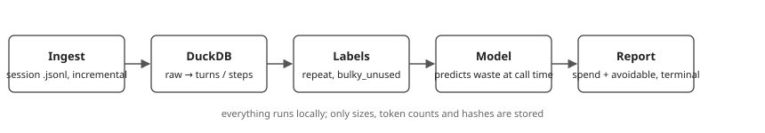

# tokenwise

Find which Claude Code plugins, skills and MCP tools you carry in every session without using them, and where your tokens go. Runs entirely on your machine.

Real output on 40 synthetic sessions (generated with `scripts/make_demo_sessions.py`, so the numbers say nothing about typical usage):

```
$ tokenwise report
Sessions analyzed: 40
Tokens processed: 193.9M
Avoidable: 63.6M tokens (33%)

Top leaks
  1. bulky_unused     47.6M
  2. repeat           10.7M
  3. other patterns   5.3M

Model: personal (AUC 0.78)

No skill listings found in the last 30 days.
```

The demo sessions have no skill listings, so that last line is all it shows there. On real sessions the same command continues with the skills you carry, by plugin, and the MCP tools by plugin or server (examples below). Tokens are counted, not dollars, so there is no price list to maintain.

## Install

```
pipx install .        # or: uv tool install .
tokenwise report
```

By default it reads `~/.claude/projects`; use `--sessions-dir` and `--db` to change locations.
Commands: `ingest`, `train`, `report`, `skills`. `report` is the one to run: it includes the skills and MCP sections. `skills` prints only those, and takes `--days N`. `train` and `report` save the trained model next to the database (`model.skops`) and reuse it until the data changes; `--retrain` forces a new one.

## Which skills cost you tokens

Every installed skill adds its name and description to the prompt of every session, whether you use it or not. `tokenwise report` (or `tokenwise skills` for just this part) lists them all by the estimated tokens spent carrying that text (written once, re-read on every later turn), with how many times you used each one, and marks the ones with zero uses as `unused`.

```
$ tokenwise skills            # last 30 days; use --days N to change
Skills loaded in 12 sessions (last 30 days)
Skill descriptions: ~900 tokens/session, ~10.8k tokens carried over these sessions. Token counts are estimates.
Data covers 2026-01-01 to 2026-01-12 (12 days), less than the 30 requested

By plugin
  big-plugin   3 skills  ~700 tokens/session  0 uses  ~8.4k tokens carried  unused
  my-tools   1 skills  ~200 tokens/session  5 uses  ~2.4k tokens carried

All skills
  big-plugin:pdf   ~400 tokens/session  0 uses  ~4.8k tokens carried  unused
  ...
```

(Synthetic numbers.) Token counts are estimated from the length of each description, and uses include both the Skill tool and `/skill` commands. Only skill names and description lengths are stored, never the text.

The same output ends with the MCP tools grouped by plugin or server (`mcp__plugin_X_…` counts as plugin X, `mcp__claude_ai_Y_…` as `claude.ai: Y`): how many tools each lists, how many you called, and `unused` when none. No size is shown for them, because the transcripts hold tool names, not their schemas.

## Use it from Claude Code

The repo is also a Claude Code plugin with one skill, so you can ask "where is my token spend going?" inside a session.

```
/plugin marketplace add FrMahon/tokenwise
/plugin install tokenwise@tokenwise
```

On Claude Code 2.1.275 or later, one step is enough: `/plugin install tokenwise --marketplace FrMahon/tokenwise`.

The skill only runs the `tokenwise` command; it does not install it. If the command is missing, it shows you the install line above and waits for you. Because Claude runs the report, its summary (spend, avoidable share, top leaks; no conversation text) appears in your session.

## How it works



1. **Ingest** the session files incrementally; unknown or truncated lines are skipped, never fatal.
2. **DuckDB layers** (SQL): raw events → deduplicated turns → tool-call steps.
3. **Labels** derived from the data: a step is *waste* if it repeats an identical earlier call+result, or returns a large result that nothing follows up on.
4. **Model** (gradient boosting) learns from your history to predict waste using only what is known when the tool is called. With fewer than 2000 steps it falls back to a bundled baseline.
5. **Report** counts the predicted waste in tokens (no prices, nothing to keep up to date).

## Privacy

Nothing leaves your machine. Conversation text is never stored: only token counts, result sizes and SHA-1 hashes of inputs and results.

## Security

See [SECURITY.md](SECURITY.md). The bundled model is stored in a safe format (not pickle) and is checked against a type allowlist before loading.

## Limitations

- "Avoidable" has no ground truth. The model predicts *patterns* of waste defined above, not verdicts.
- Claude Code's session format is not a public API and may change; unreadable lines are counted and skipped.
- Everything is counted in tokens, not dollars, so there is no price list to maintain. Cache reads count the same as fresh tokens.

## Development

```
pip install -e ".[dev]" && pytest
```
Tests use synthetic sessions only.

## License

MIT. See [LICENSE](LICENSE).
